# ETIOMS Graduation Project Audit, Traceability Matrix & 2-Day Execution Plan

**Project**: AI-Powered Ethiopian Tender Intelligence and Opportunity Management System (ETIOMS)  
**Author**: Bereket & Pair Programming Assistant  
**Timeline**: 2-Day Sprint for Graduation Project Delivery  
**Document Status**: Phase 1 Audit & Plan (Pending User Review & Approval)

---

## 1. Executive Summary

ETIOMS is an AI-powered platform designed to help Ethiopian enterprises discover, analyze, qualify, and monitor public and private procurement tenders under the FDRE Federal Public Procurement and Property Administration (FPPA) standards.

This audit evaluates the codebase against the official **Software Requirements Specification (SRS v1.0)**. The repository currently possesses a functional FastAPI backend, a Next.js 16 frontend, an active SQLite database (`etioms.db`), and operational Google Gemini (`gemini-3.6-flash`) integrations for text extraction, deterministic/semantic match scoring, and preliminary compliance audits.

However, several core SRS MVP requirements—notably **Role-Based Access Control (RBAC)**, **RAG-based Tender Q&A (FR-14)**, **Opportunity Pipeline Tracking (FR-15, FR-16)**, **Multi-Tender Side-by-Side Comparison (FR-17)**, and **AI Transparency Disclaimers (FR-12)**—are either missing or partially implemented. This document establishes a complete traceability matrix, isolates existing runtime and architectural blockers, and defines a lean, high-impact 2-day roadmap to achieve a fully demonstrable MVP.

---

## 2. Requirements Traceability Matrix

| Req ID | Requirement Description | Existing File / Endpoint | Status | Concrete Code Evidence | Minimal Work Needed | Priority |
| :--- | :--- | :--- | :--- | :--- | :--- | :--- |
| **FR-01** | User Registration & Login with RBAC (Business User, Team Member, Org Admin, System Admin) | `backend/app/routers/auth.py`<br>`backend/app/models/users.py` | **Partial** | `/api/auth/register`, `/api/auth/token`, `/api/auth/me` exist with JWT. However, `User` table schema only has `id`, `email`, `user_name`, `hashed_password`, `organization_id`, `is_active`. No `role` column exists. | 1. Add `role` column to `User` (default: `Business User`).<br>2. Expose role in token claims and `UserResponse`.<br>3. Add simple role-check dependency for admin-guarded endpoints. | **Critical** |
| **FR-02** | Company Profile Management (industry, services, regions, experience, certifications, past projects) | `backend/app/routers/profile.py`<br>`backend/app/models/organization.py`<br>`frontend/app/etioms-app.tsx` | **Implemented** | `OrganizationProfile` schema defines `company_name`, `sectors`, `operating_regions`, `years_experience`, `certifications`, `past_projects_summary`. GET/POST `/api/profile/` operational and rendered in UI. | None. Fully functional. | **Low** |
| **FR-03** | Team Member Management (invite, remove, assign permissions within organization) | `backend/app/models/organization_invite.py`<br>`backend/app/routers/auth.py` | **Partial** | `/api/auth/invitations` generates 24-hr single-use invite codes that bind new registrants to the existing `organization_id`. No member listing or removal endpoint exists. | 1. Add GET `/api/auth/members` to list organization colleagues.<br>2. Add DELETE `/api/auth/members/{id}` for Org Admins. | **Medium** |
| **FR-04** | Tender Creation / Import (manual entry, file upload, text paste) | `backend/app/routers/tenders.py` | **Implemented** | POST `/api/tenders` (manual JSON), POST `/api/tenders/upload` (PDF/TXT file or pasted text), POST `/api/tenders/ingest` (notice text). | None. Core endpoints work. | **Low** |
| **FR-05** | Tender Listing & Categorization (by sector, status, organization, archiving) | `backend/app/routers/tenders.py`<br>`backend/app/models/tender.py` | **Implemented** | GET `/api/tenders` returns all tenders. `Tender` model has `sector`, `region`, `status`, `procuring_entity`. | Optional PATCH `/api/tenders/{id}/status` for status update/archiving. | **Low** |
| **FR-06** | Tender Search & Filtering (keyword, category, sector, location, deadline, status) | `backend/app/routers/tenders.py`<br>`frontend/app/etioms-app.tsx` | **Partial** | Frontend filters loaded matches by entity, sector, and minimum match score. Backend `GET /api/tenders` has no query parameters for multi-facet filtering. `GET /api/tenders/semantic-search` exists but crashes because `Tender.embedding` column is missing. | 1. Add query params to `GET /api/tenders` (`sector`, `region`, `status`, `search`).<br>2. Fix or safe-guard `semantic-search`. | **High** |
| **FR-07** | Tender Detail View (full details, linked source documents, dedicated view) | `backend/app/routers/tenders.py`<br>`frontend/app/etioms-app.tsx` | **Implemented** | GET `/api/tenders/{id}` returns complete row. Frontend drawer displays facts, deadline, budget, requirements, and compliance audit. | Add direct download/view link to `raw_document_path` if uploaded. | **Medium** |
| **FR-08** | Tender Document Management (PDF/DOCX storage, attachment to tender record) | `backend/app/routers/tenders.py` | **Implemented** | Uploaded documents stored to `uploads/` directory; file path saved in `tender.raw_document_path`. | None for MVP. | **Low** |
| **FR-09** | Document Text Extraction (extract text from tender docs, OCR fallback) | `backend/app/services/pdf_service.py` | **Implemented** | `extract_text_from_pdf` uses `pypdf` with fallback. Successfully extracts text from uploaded PDF tenders. | (OCR for scanned images can remain fallback/simulated for MVP). | **Medium** |
| **FR-10** | AI Requirement Extraction (structured fields: title, entity, sector, region, deadline, budget, requirements) | `backend/app/services/ingestion_service.py`<br>`backend/app/services/ai_service.py` | **Implemented** | Gemini `ExtractedTenderSchema` structured JSON generation with `gemini-3.6-flash` parses raw notices into structured fields and stores in `tender.extracted_requirements`. | None. Fully functional. | **Low** |
| **FR-11** | AI Tender Summarization (concise summary covering procurement, eligibility, tech specs, risks) | `backend/app/services/ai_service.py`<br>`backend/app/models/tender.py` | **Implemented** | `tender.ai_summary` populated during ingestion and dossier generation. | None. Fully functional. | **Low** |
| **FR-12** | AI Output Labeling (visually distinguish AI analysis, summaries, and match scores from official data) | `frontend/app/etioms-app.tsx` | **Partial** | Some sections have "GEMINI ANALYSIS" headers, but SRS explicitly mandates clear disclaimer badges separating AI predictions from legal procurement documents. | Add unified UI Badge/Banner: *"AI-Generated Analysis · Verify with Official Tender Document"* across Match Drawer & Ingest results. | **High** |
| **FR-13** | Company-Tender Matching (0-100% score with breakdown of sector, region, experience, AI semantic capability) | `backend/app/services/matching_service.py`<br>`backend/app/routers/profile.py` | **Implemented** | 70% deterministic (sector 25, region 20, experience 25) + 30% AI semantic fit via Gemini. Breakdown persisted in `tender_matches` table. | Add partial-profile guidance when company profile has missing certifications. | **Medium** |
| **FR-14** | RAG-Based Tender Q&A (Natural language questions answered strictly from indexed tender documents with citations) | *None* | **Missing** | Acceptance criteria explicitly tests: *"What documents are required for this tender?"* -> returns answer with section/page citation; falls back gracefully if not found. Currently no `/api/tenders/{id}/ask` exists. | 1. Implement `/api/tenders/{id}/ask` using Gemini with grounded context from `raw_document_path` or `requirements`.<br>2. Add simple Q&A chat box inside Tender Detail Drawer. | **Critical** |
| **FR-15** | Save / Bookmark Tenders (save tenders of interest to organization's tracked opportunities) | *None* | **Missing** | No database model or endpoint currently links a tender to an organization's saved pipeline list. | 1. Create `OpportunityTracking` model.<br>2. Add POST `/api/tenders/{id}/save`.<br>3. Add "Save Opportunity" button in Tender UI. | **High** |
| **FR-16** | Opportunity Pipeline Tracking (Progress saved tenders through: Discovered -> Interested -> Analyzing -> Preparing -> Submitted -> Awarded / Not Awarded; attach notes) | *None* | **Missing** | Section 11.6 & FR-16 mandate opportunity pipeline tracking with stage transitions and notes. | 1. Add `OpportunityTracking` table with status enum and notes.<br>2. Add GET `/api/opportunities` & PUT `/api/opportunities/{id}/status`.<br>3. Add Pipeline view in frontend. | **Critical** |
| **FR-17** | Opportunity Comparison (Select and compare 2+ tender opportunities side by side) | *None* | **Missing** | Section 16 & FR-17 require side-by-side comparison of budget, deadline, sector, match score, and compliance status. | 1. Add POST `/api/tenders/compare` (accepts array of UUIDs).<br>2. Add simple Compare modal/drawer in frontend. | **High** |
| **FR-18** | Notifications (In-app and email alerts for new matching tenders and approaching deadlines) | *None* | **Missing** | Section 11.7 requires `Notification` table and retrieval endpoint. | 1. Add `Notification` table (`id`, `user_id`, `type`, `message`, `read_flag`, `created_at`).<br>2. Add GET/PATCH `/api/notifications`.<br>3. Add notification bell indicator in frontend header. | **Medium** |
| **FR-19** | Organization Dashboard (Summary of matching tenders, saved opportunities, deadlines this week, high matches) | `frontend/app/etioms-app.tsx` | **Partial** | Current dashboard displays 4 metrics: Total opportunities, Qualified, Disqualified, and Average score. Needs "Deadlines this week" and "Saved pipeline" widgets. | Update Dashboard metrics grid to compute and display: Upcoming Deadlines (<7 days) and Active Pipeline count. | **Medium** |
| **FR-20 to FR-24** | System Administration (User/Org management, category/source config, ingestion & AI error monitoring) | `backend/app/routers/` | **Partial** | Basic user/org associations exist. Ingestion logs and category management are partially handled via API endpoints, but no dedicated Admin dashboard exists. | Expose a lightweight `/api/admin/metrics` endpoint reporting total users, tenders, and AI ingestion status. | **Low** |

---

## 3. Investigation of the `Baseclin` Startup Blocker

### The Error
```python
ImportError: cannot import name 'Baseclin' from 'backend.app.database'
```

### Root Cause Analysis
1. In `backend/app/database.py`, line 17 instantiates the declarative base class:
   ```python
   Base = declarative_base()
   ```
2. In `backend/app/models/tender.py`, line 4 previously contained an inadvertent typo:
   ```python
   from backend.app.database import Baseclin  # <-- Error
   ```
   While line 20 defined the model inheriting from `Base`:
   ```python
   class Tender(Base):
   ```
3. Because multiple other model files (`organization.py`, `users.py`, `organization_invite.py`) import the custom `GUID` TypeDecorator from `backend.app.models.tender`, this single syntax error cascaded, crashing the entire FastAPI app on startup when `backend.app.main` imported any model or router.

### Resolution & Verification
- **Fix applied**: Changed line 4 of `backend/app/models/tender.py` to:
  ```python
  from backend.app.database import Base
  ```
- **Verification**: Executed import test in the project's virtual environment. All 9 core API route groups registered without errors and the server startup test exited with code 0.

---

## 4. Critical Blockers & Technical Debt Analysis

### Blocker 1: Missing Column `Tender.embedding` breaks Semantic Search
- **Issue**: In `backend/app/routers/tenders.py` line 170:
  ```python
  if not tender.embedding:
  ```
  The `Tender` SQLAlchemy model has no `embedding` column. Calling `GET /api/tenders/semantic-search` immediately throws an `AttributeError`.
- **Minimal Fix**: Generate the embedding on the fly from `tender.title + tender.description` in memory for search comparisons, or add `embedding = Column(JSON, nullable=True)` to `Tender`.

### Blocker 2: User Role Missing from Data Model
- **Issue**: SRS FR-01 and Section 11.1 specify that `User` must possess a `Role` (`Business User`, `Team Member`, `Organization Admin`, `System Admin`). The current `User` table lacks this column.
- **Minimal Fix**: Add `role = Column(String(50), nullable=False, default="Business User")` to `backend/app/models/users.py`.

### Blocker 3: Tracked `venv/` Directory in Git Working Tree
- **Issue**: Over 100 `.pyc` and virtualenv binaries are currently tracked in Git because `venv/` was committed before `.gitignore` was configured. This clutters `git status` and could accidentally corrupt environment packages during commits.
- **Minimal Fix**: Run `git rm -r --cached venv` and commit the untracking.

### Blocker 4: Single-Tenant vs Multi-Tenant Organization Assumption
- **Issue**: `backend/app/routers/profile.py` line 57 comments say *"Creates or updates the single-tenant enterprise profile"*, but the code properly keys on `current_user.organization_id`. Ensure all pipeline queries consistently filter by `organization_id` so data remains isolated per organization (Non-Functional Requirement: Security & Privacy).

---

## 5. Scope Definition: The Demonstrable MVP

To fulfill graduation project requirements and satisfy all acceptance criteria in the SRS within 1–2 days, we focus on the **Smallest High-Impact Feature Set**:

```
+---------------------------------------------------------------------------------+
|                                 ETIOMS MVP SCOPE                                |
+---------------------------------------------------------------------------------+
| 1. Full Authentication & Roles (Org Admin, Business User, Team Member)           |
| 2. Tender Ingestion & Gemini AI Extraction (Upload PDF / Paste Text)            |
| 3. Multi-Factor Search & Filtering (Sector, Region, Deadline, Min Match Score)   |
| 4. Opportunity Matching & FPPA Compliance Audit (70% Heuristic + 30% AI)        |
| 5. Grounded RAG Tender Q&A with Document Citations (FR-14 Acceptance Criteria)  |
| 6. Opportunity Pipeline Kanban (Discovered -> Interested -> Preparing -> Awarded)|
| 7. Side-by-Side Tender Comparison View (FR-17)                                  |
| 8. In-App Notification System & Deadline Alert Indicators                       |
| 9. Visible AI Transparency Disclaimer Badges (FR-12)                            |
+---------------------------------------------------------------------------------+
```

---

## 6. Realistic 2-Day Prioritized Execution Plan

```mermaid
gantt
    title ETIOMS 2-Day Execution Roadmap
    dateFormat  HH:mm
    axisFormat  %H:%M
    section Day 1: Core Backend & Data Models
    Untrack venv & fix Semantic Search Blocker  :09:00, 1h
    Add User Role, Opportunity, Notification Models :10:00, 2h
    Implement RAG Q&A Engine (/api/tenders/ask) :12:00, 2h
    Implement Pipeline & Save APIs               :14:00, 2h
    Implement Compare & Multi-facet Filter APIs  :16:00, 2h
    section Day 2: Frontend & Acceptance Verification
    Pipeline Kanban / List View                  :09:00, 2h
    RAG Q&A Chat Box inside Tender Drawer        :11:00, 2h
    Side-by-Side Tender Comparison Modal         :13:00, 2h
    AI Transparency Labels & Notification Bell   :15:00, 1h
    End-to-End Acceptance Testing & Demo Prep    :16:00, 3h
```



### Day 1: Backend Services, Models & API Endpoints

#### Block 1 (Morning): Hygiene & Foundation
- Untrack `venv/` from git index (`git rm -r --cached venv`).
- Fix `Tender.embedding` attribute bug in `semantic-search`.
- Update `backend/app/models/users.py`: add `role` column (`Business User`, `Team Member`, `Organization Admin`, `System Admin`).
- Create `backend/app/models/opportunity.py` for pipeline tracking (`Discovered`, `Interested`, `Analyzing`, `Preparing`, `Submitted`, `Awarded`, `Not Awarded`) with notes.
- Create `backend/app/models/notification.py` for user alerts.

#### Block 2 (Afternoon): RAG Q&A & Pipeline Endpoints
- Implement `backend/app/services/rag_service.py`:
  - Receives question + `tender_id`.
  - Reads tender document text or extracted requirements.
  - Queries Gemini with citation grounding prompt (citing section/page; stating "Information not found" if missing).
- Add endpoint `POST /api/tenders/{id}/ask` in `tenders.py`.
- Implement `backend/app/routers/opportunities.py`:
  - `POST /api/tenders/{id}/save` -> creates tracked opportunity in `Discovered` state.
  - `GET /api/opportunities` -> lists organization's active pipeline.
  - `PUT /api/opportunities/{id}/status` -> updates state and adds progression notes.
- Implement `POST /api/tenders/compare` in `tenders.py` to return side-by-side matrices.

---

### Day 2: Frontend UI Integration & Demo Polish

#### Block 3 (Morning): Pipeline & RAG Q&A in UI
- Add **Pipeline View** (`/opportunities` or new tab in `etioms-app.tsx`):
  - Shows opportunities organized by status stages.
  - Quick action to advance status (e.g. `Discovered` -> `Analyzing` -> `Preparing` -> `Submitted`).
  - Ability to view and append notes.
- Add **RAG Q&A Chat** to `MatchDrawer`:
  - Quick question input: *"Ask a question about this tender (e.g., required bid security, submission envelope rules)"*.
  - Displays answer with page/section citations and clear grounding.

#### Block 4 (Afternoon): Comparison, AI Disclaimers & Notifications
- Add **Side-by-Side Comparison Modal**:
  - Allows selecting 2–3 tenders from dashboard to compare budget, sector, deadline, requirements, and compliance score side by side.
- Add **AI Transparency Badges** across all views:
  - *"AI-Generated Analysis · Verify with Official Tender Document"*.
- Add **Notification Bell & Deadlines Indicator**:
  - Displays approaching deadlines (tenders closing within 7 days).

#### Block 5 (Evening): End-to-End Verification & Graduation Demo Script
- Execute the 3 SRS Acceptance Criteria:
  1. **Tender Search & Filtering**: Filter by sector and 30-day deadline window.
  2. **AI Matching**: Verify match percentage, breakdown, and partial-profile flag.
  3. **RAG Q&A**: Ask about required documents and verify citation + unsupported query fallback.
- Prepare a standard 5-minute presentation walkthrough script showcasing real Ethiopian NCB tender examples (e.g. CBE, Ethio Telecom).

---

## 7. Next Steps for Approval
Please review this audit and plan. Once you confirm, we will immediately initiate **Day 1 Block 1** (Git hygiene, models extension, and semantic-search fix).
