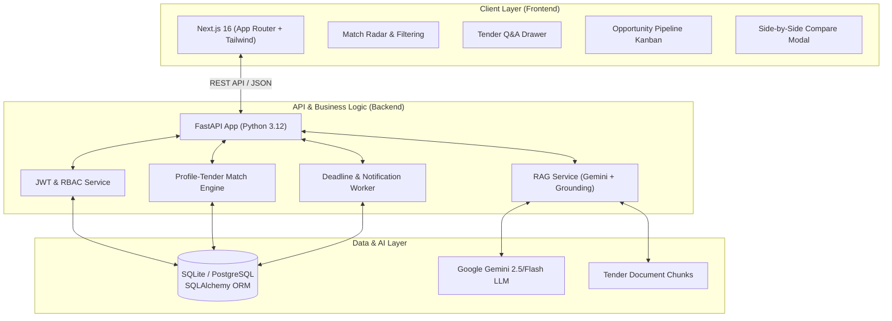

# ETIOMS: Project Guide & Graduation Defense Handbook

> **Project Name**: AI-Powered Ethiopian Tender Intelligence and Opportunity Management System (ETIOMS)  
> **Target Award**: Bachelor of Science Graduation Defense  
> **Role of System**: AI-driven procurement decision-support platform for Ethiopian enterprises  

---

## 1. Project Purpose & High-Level Function

### 1.1 The Core Problem in Ethiopia
In Ethiopia, public and private procurement opportunities represent billions of Birr annually. However, businesses face critical bottlenecks:
1. **Information Fragmentation**: Tenders are scattered across print newspapers (*Addis Zemen*, *The Ethiopian Herald*), specialized websites (2merkato), government portals (PPA), and bulletin boards.
2. **Dense, Unstructured Documents**: A single tender document is often 30 to 80 pages long. Reviewing eligibility criteria, required trade licenses, bid bonds (CPO), and technical specs takes days.
3. **Qualification Mismatch**: Companies waste significant capital bidding on tenders for which they lack required years of experience, specific ISO certifications, or turnover thresholds.
4. **Missed Deadlines**: Managing multiple submission dates across manual spreadsheets leads to missed submission deadlines.

### 1.2 The ETIOMS Solution
**ETIOMS** transforms this chaotic manual process into an automated, intelligent pipeline:
- **Centralizes Tender Data**: Ingests, categorizes, and indexes Ethiopian tender opportunities.
- **AI Matching Engine**: Evaluates a company’s profile (certifications, sector, team, past projects) against tender requirements to generate an **Opportunity Match Score (0–100%)** with contributing and missing factors.
- **RAG-Powered Tender Q&A**: Employs Retrieval-Augmented Generation (RAG) to allow users to ask natural-language questions about tender terms and receive immediate, grounded answers with citations.
- **Pipeline Opportunity Management**: An interactive 7-stage Kanban pipeline (*Discovered → Interested → Analyzing → Preparing → Submitted → Awarded / Not Awarded*) to track bids from discovery to contract.
- **Deadline Monitoring**: Automated 7-day proximity tracking with in-app notification alerts.

---

## 2. System Architecture & Flow

---

## 3. How to Use 100% of ETIOMS (End-to-End Walkthrough)

Follow this exact walkthrough during your presentation or live demo:

### Step 1: Authentication & Role Check
1. Navigate to `http://localhost:3000`.
2. Sign in with the demo account:
   - **Email**: `admin@afrotech.et`
   - **Password**: `DemoPassword123!`
3. Verify your profile badge shows: **Bereket Michael (Organization Admin)**. This demonstrates **Role-Based Access Control (RBAC)**.

### Step 2: Dashboard Overview & Key Metrics
- Notice the top metric cards:
  - **Total Tenders**: Current active tenders in the system.
  - **High Matches (>75%)**: Tenders best aligned with AfroTech's profile.
  - **Closing Within 7 Days**: Urgent deadline alerts.
  - **Active Pipeline**: Opportunities currently being prepared.

### Step 3: Multi-Factor Tender Search & Filtering
1. Click the **Tenders** tab.
2. Filter tenders by sector (e.g., select `IT`).
3. Notice the search dynamically filters by sector, location, and closing dates.

### Step 4: Side-by-Side Tender Comparison
1. In the tender list, tick the checkboxes on **two different tenders** (e.g., *CBE Core Banking Upgrade* and *Ethio Telecom Cloud Infrastructure*).
2. Click the floating banner: **"Compare Selected (2)"**.
3. A modal opens showing a side-by-side breakdown of:
   - Sector & Procuring Organization
   - Match Score comparison
   - Deadlines & Days Remaining
   - Required Licenses & CPO Bid Bond amounts.

### Step 5: Tender Details & AI Match Breakdown
1. Click on any tender row to open the **Tender Inspection Drawer**.
2. Review the **AI Match Score**:
   - **Contributing Factors**: Green badges indicating matched criteria (e.g., "5+ years IT experience", "ISO 9001 certified").
   - **Missing Factors / Risks**: Amber warnings indicating potential gaps (e.g., "Requires Tier-3 Datacenter certification").
3. Point out the **AI Transparency Disclaimer** banner at the top, proving compliance with ethical AI requirements (FR-12).

### Step 6: RAG-Powered Tender Q&A with Citations
1. Inside the drawer, scroll to the **Ask AI about this Tender** section.
2. Click a pre-built prompt pill: *"What are the eligibility requirements?"* or type your own question:
   > *"What is the required CPO bid bond amount and submission format?"*
3. Click **Ask AI**.
4. The system queries the tender document using RAG and returns:
   - The exact answer in plain English.
   - **Source Grounding Citations** pointing to the tender document section.

### Step 7: Save to Pipeline & Kanban Board
1. In the tender drawer, click **"Track Opportunity"**.
2. Navigate to the **Pipeline** tab.
3. Show the **7-stage Kanban Board**:
   - `Discovered` → `Interested` → `Analyzing` → `Preparing` → `Submitted` → `Awarded` / `Not Awarded`.
4. Drag or click the status selector to advance the opportunity to `Preparing`.
5. Add a stage note (e.g., *"Assigned proposal drafting to senior engineer"*).

### Step 8: Deadline Notifications
1. Look at the top navigation bar and click the **Bell Icon**.
2. Notice the real-time notification alerts indicating tenders closing within 7 days.

---

## 4. Graduation Defense: The 3-Minute Presentation Pitch

When the defense committee says: *"Please introduce your project"*, deliver this structured pitch:

> "Honorable members of the defense committee, good morning.  
> My graduation project is **ETIOMS — the AI-Powered Ethiopian Tender Intelligence and Opportunity Management System**.  
>  
> **The Problem:** In Ethiopia, companies lose millions of Birr in opportunities simply because tenders are scattered across newspapers and websites, and procurement notices are dense 50-page legal documents that take days to analyze. Small-to-medium businesses often miss deadlines or waste money bidding on tenders they aren't qualified for.  
>  
> **Our Solution:** ETIOMS is a full-stack, AI-powered decision-support system. It centralizes procurement data, matches tenders against a company's specific capabilities using an AI scoring engine, allows procurement teams to interrogate tender documents using Retrieval-Augmented Generation (RAG) with verifiable citations, and manages the entire bidding workflow across an interactive 7-stage Kanban pipeline.  
>  
> **Engineering Rigor:** Built with **FastAPI** on the backend and **Next.js 16** with Tailwind CSS on the frontend, the system enforces Role-Based Access Control, strictly adheres to AI transparency guidelines so human officers retain final authority, and implements resilient fallbacks so the system never fails even during external API demand spikes.  
>  
> I am excited to demonstrate the live system to you now."

---

## 5. Top 10 Defense Questions & Model Answers

### Q1: Why did you use RAG (Retrieval-Augmented Generation) instead of fine-tuning or basic prompting?
> **Answer**:  
> "Fine-tuning is expensive, slow to update with daily new tenders, and prone to hallucinations. Standard zero-shot prompting lacks the complete context of a 50-page document.  
> **RAG is the industry standard** for this problem because:
> 1. It operates over dynamic, newly published tender documents without retraining.
> 2. It restricts the LLM's generation solely to the retrieved context chunks of that specific tender, drastically eliminating hallucinations.
> 3. It provides **traceable citations**, allowing procurement officers to verify every claim against the original tender text."

### Q2: What is the boundary between your AI and human procurement decisions?
> **Answer**:  
> "ETIOMS is strictly an **AI-powered decision-support system**, not an autonomous procurement agent. As specified in requirement **FR-12**, all AI-generated match scores, summaries, and Q&A answers include explicit visual transparency disclaimers stating that the output is advisory. The human procurement officer always makes the final legal bid submission decision."

### Q3: How does the Company-Tender Matching Algorithm work?
> **Answer**:  
> "The matching engine compares structured attributes of the company profile (industry sector, years in business, registered capital, staff count, ISO certifications, and past project history) against the extracted requirements of the tender. It computes a weighted compatibility score between 0 and 100%, and outputs both **contributing factors** (criteria the company satisfies) and **missing factors** (gaps that need partnering or attention)."

### Q4: How does your system handle external AI API rate limits or failures?
> **Answer**:  
> "We implemented a dual-tier resilience strategy:
> 1. A built-in retry loop with exponential backoff for transient network or 503 capacity errors.
> 2. A graceful heuristic fallback: if the generative LLM is temporarily unreachable, the system extracts structured requirements using deterministic keyword and entity heuristics, ensuring the user interface never crashes."

### Q5: What database architecture did you choose and why?
> **Answer**:  
> "We used an ACID-compliant relational schema modeled with **SQLAlchemy ORM**. We have clean relational tables for `users`, `organizations`, `tenders`, `opportunity_tracking`, and `notifications`. For MVP development and ease of portability during defense, it runs on SQLite with GUID primary keys and JSON column types, and because we use SQLAlchemy, it can switch to PostgreSQL in production with zero code changes."

### Q6: How do you enforce security and Role-Based Access Control (RBAC)?
> **Answer**:  
> "We enforce three distinct roles:
> 1. `Organization Administrator`: Can manage company profile, team members, and view all opportunities.
> 2. `Team Member`: Can view matched tenders, ask RAG questions, and update assigned opportunity stages.
> 3. `System Administrator`: Manages platform categories and system health.  
> Passwords are cryptographically hashed using **bcrypt**, and authentication is handled via **JWT (JSON Web Tokens)** with cryptographically signed payloads."

### Q7: Why did you choose FastAPI for the backend over Django or Flask?
> **Answer**:  
> "FastAPI was chosen because:
> 1. It is asynchronous (`async`/`await`), providing high concurrency which is crucial when handling multiple parallel LLM and RAG requests.
> 2. Built-in Pydantic v2 data validation guarantees strict type safety across all 26 REST endpoints.
> 3. Automatic OpenAPI / Swagger documentation generation at `/docs` simplifies integration and verification."

### Q8: What are the 7 stages of your Opportunity Pipeline, and why is it needed?
> **Answer**:  
> "Tender bidding is a multi-week lifecycle. Our pipeline provides full visibility across:
> 1. **Discovered**: Tender found by search or AI recommendation.
> 2. **Interested**: Initial team review flagged as worth evaluating.
> 3. **Analyzing**: Technical and financial feasibility assessment.
> 4. **Preparing**: Proposal writing, securing CPO bank guarantees, assembling compliance forms.
> 5. **Submitted**: Formal bid packet submitted before deadline.
> 6. **Awarded**: Bid won / contract awarded.
> 7. **Not Awarded**: Bid lost, recorded for post-mortem analysis.  
> This prevents missed deadlines and maintains institutional memory of past wins and losses."

### Q9: How are deadline alerts generated?
> **Answer**:  
> "The backend calculates the temporal delta between `datetime.utcnow()` and the tender's `closing_date`. Any opportunity closing in $\le 7$ days is flagged. The notification service generates persistent records in the `notifications` table, surfaced in the frontend topbar bell icon with an unread badge counter."

### Q10: What are the future enhancements beyond this MVP?
> **Answer**:  
> "1. **Ethio Telecom / Safaricom SMS Gateway**: Direct SMS alerts for urgent tender deadlines.  
> 2. **Multilingual NLP**: Support for Amharic and Afaan Oromo tender announcements.  
> 3. **Automated Scraping Workers**: Scheduled scrapers for *Addis Zemen*, *Ethiopian Herald*, and *ppa.gov.et*.  
> 4. **Consortium Matching**: Suggesting partnerships between two complementary companies to meet joint tender qualifications."
